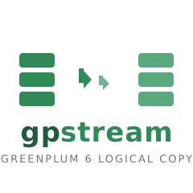

<p align="center"></p>

# gpstream

High-throughput **logical** data copy between two Greenplum 6 clusters over a
direct high-speed network — **no intermediate storage**, snapshot consistency,
crash-recovery, background index rebuild, redistribution accounting, and a
fully deterministic `--dry-run` plan.

> **Milestone status (this build):** M1 core **verified**. `run` now performs a
> real transfer — it is wired into the job Manager (source → stream → dest) and
> proven against live PostgreSQL clusters by the `tests/integration`
> suite (build tag `integration`). `doctor` reports real reachability failures
> (no silent fake fallback). Greenplum-specific paths (segment fan-out,
> `gp_segment_connect`) and live-cluster chaos (`kill -9` resume, 100 Gbit/s
> channel) are validated via the PG/fake substitute, not a live Greenplum — see
> `RC-CHECKLIST.md`.

## Why streaming, not `gpbackup`/`gpcopy`

- `gpbackup`/`gprestore` need external storage ≥ the size of the DB
  (100 TB–1 PB) — infeasible on cost.
- `gpcopy` is proprietary (Broadcom) — its code may not be used.
- **Logical streaming** via `COPY` (binary) is also **insensitive to
  differences in OS/kernel/glibc between clusters**: data is rewritten on the
  copy, not moved in binary form.

## Requirements at a glance

| ID | Requirement |
|---|---|
| F-01 | Copy over the network, no intermediate storage |
| F-02 | Snapshot consistency + cleanup of orphaned data |
| F-03 | Performance independent of DB architecture (100 000 small AO/CO tables) |
| F-04 | Monitoring and metrics |
| F-05 | Packaging, self-diagnostic, man, documentation |
| F-06 | Resilience, `--auto-resume N` |
| F-07 | Crash-recovery: integrity check, minimal rollback |
| F-08 | Minimal dependencies, free licenses only |
| F-09 | Automated tests |
| F-10 | `--dry-run`: availability, volume/time estimate, conflicts, plan |
| F-11 | Selection, data safety, rename |
| F-12 | zlib / zstd compression |
| F-13 | TLS, certificates |
| F-14 | Rate limits, bottleneck auto-detection |
| F-15 | Redistribution accounting |
| F-16 | Different OS/kernel/glibc, COLLATION |
| F-17 | Background index rebuild |
| F-18 | Project name `gpstream` |

## CLI contract (§8)

```
gpstream run
  --source "<connstr>" --dest "<connstr>"
  (--dbs D... | --schemas D.S... | --tables D.S.T...) [--exclude ...]
  [--resolve-conflicts stop|skip|overwrite|truncate]   # default: stop
  [--overwrite | --truncate]                           # explicit opt-ins
  [--map-db src=dst] [--map-schema src=dst] [--map-table src=dst]
  [--compress none|zlib|zstd[:level]] [--zstd-level N]
  [--small-table-threshold SIZE]                       # F-12, default 1MiB
  [--copy-mode coordinator|on_segment|direct]
  [--seg-listen HOST:PORT] [--seg-binary PATH]
  [--seg-tls-cert F --seg-tls-key F --seg-tls-ca F]
  [--workers N] [--rate-limit <Gbps>]
  [--auto-resume N] [--resume-consistency relaxed|strict]
  [--on-unit-failure continue|abort]
  [--frame-ack on|off] [--ack-timeout 15s|30s|adaptive]
  [--max-reconnects N] [--retransmit-buffer-max SIZE]
  [--verify full|sample|off]                           # default: sample
  [--index-workers N | --no-indexes] [--index-priority size|fifo]    # default: size
  [--no-redistribute | --skew-threshold X | --segment-balance-threshold X]
  [--ssl-ca F]                                         # pg plane TLS (connstring sslmode=verify-full default)
  [--operation-id <id>] [--state-dir DIR]
  [--timeout S] [--plan-file F]
  [--config file.toml]

gpstream dry-run  [--timeout S] [--plan-file F]   # same selection flags as run
gpstream status   --operation-id <id>
gpstream resume   --operation-id <id>
gpstream cleanup  --operation-id <id> [--all-incomplete] [--mode drop] [--dest <conn>]
gpstream doctor   [--source ...] [--dest ...]
gpstream selftest
gpstream version
gpstream man [topic]
```

Priority: CLI flag > environment > config file > default. Config file:
`/etc/gpstream/gpstream.toml`; state: `/var/lib/gpstream/<operation-id>/`.
The full flag reference is in [docs/CLI_REFERENCE.md](docs/CLI_REFERENCE.md).

## Build

```sh
go build -o bin/gpstream ./cmd/gpstream
# cross-compile
GOOS=linux GOARCH=arm64  go build -o bin/gpstream-arm64  ./cmd/gpstream
GOOS=linux GOARCH=amd64  go build -o bin/gpstream-amd64  ./cmd/gpstream
```

> The module proxy `proxy.golang.org` intermittently 403s
> `github.com/klauspost/compress`; the build env sets
> `GOPROXY=https://proxy.golang.org,direct` so the git-clone fallback works.

## Test

```sh
go test -cover ./...
```

## Layout

```
gpstream/
├── cmd/gpstream/            # main, subcommands, flag parsing, help
├── internal/
│   ├── plan/                # plan, volume estimate, routing, collation, conflicts
│   ├── route/               # copy-mode routing (coordinator/on_segment/direct)
│   ├── topology/            # cluster/segment discovery
│   ├── transfer/            # framing, reliable pipe, stream engine
│   │   ├── pg/              # COPY TO/FROM, schema DDL, conn pool
│   │   ├── source/          # source-side read path
│   │   ├── dest/            # dest-side write path, segment balance
│   │   ├── segstream/       # segment-direct data plane (on_segment/direct)
│   │   └── compress/        # zstd/zlib
│   ├── manifest/            # operation manifest, dest objects, resume
│   ├── monitor/             # metrics, events, /metrics
│   ├── ratelimit/           # adaptive rate limit (AIMD), /proc metrics
│   ├── index/               # background index builder
│   ├── doctor/              # self-diagnostic
│   ├── config/              # config file + env + defaults
│   ├── pgtest/              # live-PG test harness
│   └── selftest/            # internal sanity checks
├── man/gpstream.8
├── docs/                    # CLI reference, metrics, quickstart, guides
├── packaging/               # systemd, rpm/deb, logrotate, examples
├── tests/                   # unit, integration, chaos, perf
└── .github/workflows/       # CI
```

## License

Apache-2.0. See [LICENSE](LICENSE).
